# EduVault – Cloud-Based Student Document Management System

> A serverless web application on **Amazon Web Services** that lets students securely store, organise, preview and download their academic documents from anywhere.


### 🌐 Live Demo: **[https://d1qub8ki2toxxc.cloudfront.net/](https://d1qub8ki2toxxc.cloudfront.net/)**

Hosted on AWS (S3 + CloudFront). Create an account with your Student ID to try it.

**CAT-3 Minor Project** · Department of Computer Science & Engineering
**Author:** Govardhana J M · **USN:** ENG23CS0069

---

## Table of Contents
1. [Problem Statement](#problem-statement)
2. [Objectives](#objectives)
3. [Key Features](#key-features)
4. [Application Screenshots](#application-screenshots)
5. [AWS Services Used](#aws-services-used)
6. [System Architecture](#system-architecture)
7. [How It Works](#how-it-works)
8. [Database Design](#database-design)
9. [Security Features](#security-features)
10. [AWS Console Screenshots](#aws-console-screenshots)
11. [Tech Stack](#tech-stack)
12. [Project Structure](#project-structure)
13. [Getting Started](#getting-started)
14. [API Reference](#api-reference)
15. [Possible Improvements](#possible-improvements)
16. [Conclusion](#conclusion)
17. [License](#license)

---

## Problem Statement

| Problem | Description |
|---------|-------------|
| **Documents get lost or damaged** | Marksheets, certificates and ID proofs are kept as paper copies that wear out or go missing. |
| **Repeated photocopies** | Students make new photocopies for every admission, scholarship or job application. |
| **No access from anywhere** | Files stored on one phone or laptop are not available when needed elsewhere. |
| **Privacy risks** | Sharing documents over chat apps or public drives exposes personal data. |

## Objectives

- **Store securely** – keep every student's documents in private cloud storage.
- **Authenticate users** – register and log in with hashed passwords and signed sessions.
- **Organise and find** – categorise, search, preview and download documents quickly.
- **Go serverless** – no servers to manage, automatic scaling, near-zero cost at student scale.

## Key Features

| Feature | Details |
|---------|---------|
| 🔐 Login & Register | Student ID (USN), email, department and password |
| 📊 Smart Dashboard | Total files, storage used, categories used, last upload, recent uploads and category chart |
| ⬆️ Drag & Drop Upload | Multiple files at once with a live progress bar, up to 10 MB each (PDF, JPG, PNG, DOC, DOCX) |
| 🏷️ Categories | Marksheet, Certificate, ID Proof, Fee Receipt, Other |
| 👁️ Preview & Download | Open files in the browser or save them instantly via short-lived secure links |
| 🔎 Search & Filter | Find documents by name, category, and sort by date, name or size |
| 🗑️ Delete | Permanently remove a document from S3 and DynamoDB |
| 👤 Profile | Account details and a summary of how data is protected |

## Application Screenshots

### Login & Register
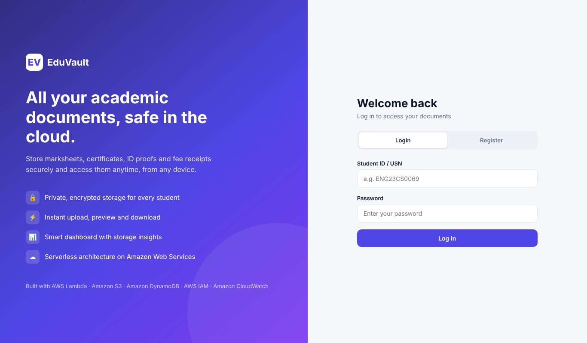

### Dashboard
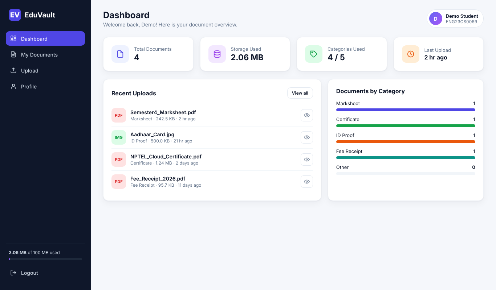

### My Documents
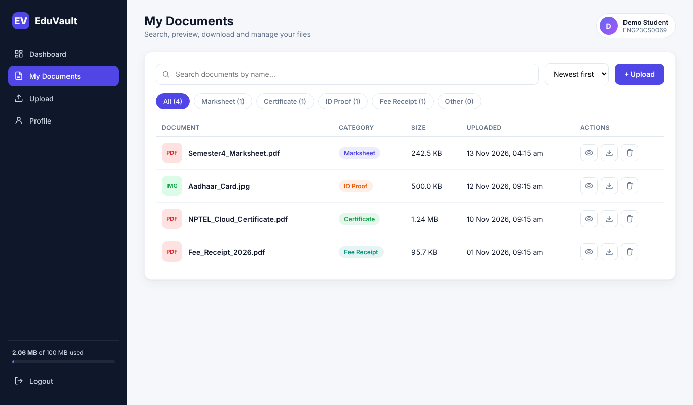

### Upload
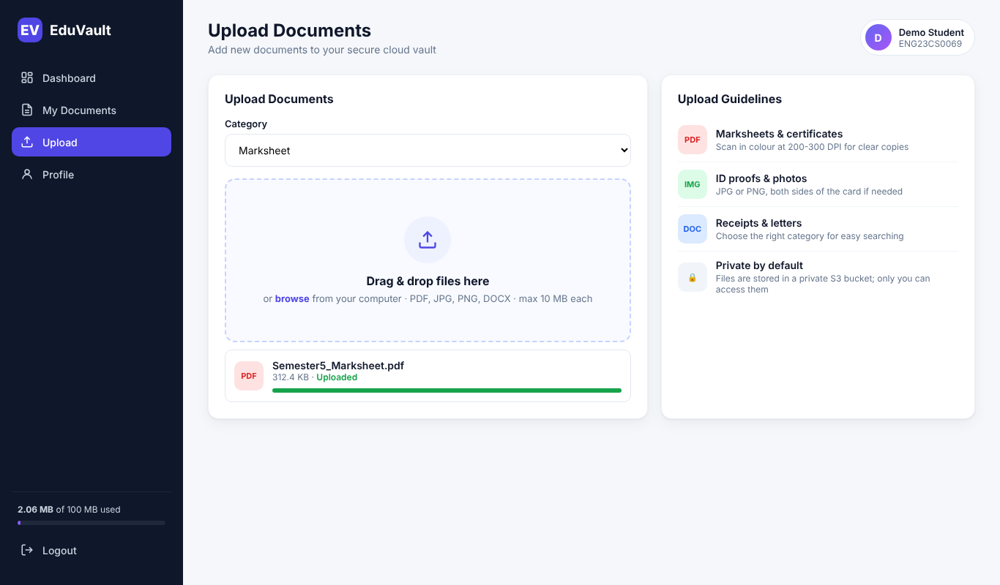

## AWS Services Used

| Service | Role in the project |
|---------|--------------------|
| **Amazon S3** | Stores the document files in a private bucket, one folder per student |
| **AWS Lambda** | Python backend: register, login, upload, list, view, download, delete |
| **Amazon DynamoDB** | Two tables: student accounts and document details |
| **AWS IAM** | Role that lets Lambda use only S3, DynamoDB and logging |
| **Amazon CloudWatch** | Logs every login, upload, download and delete |

## System Architecture

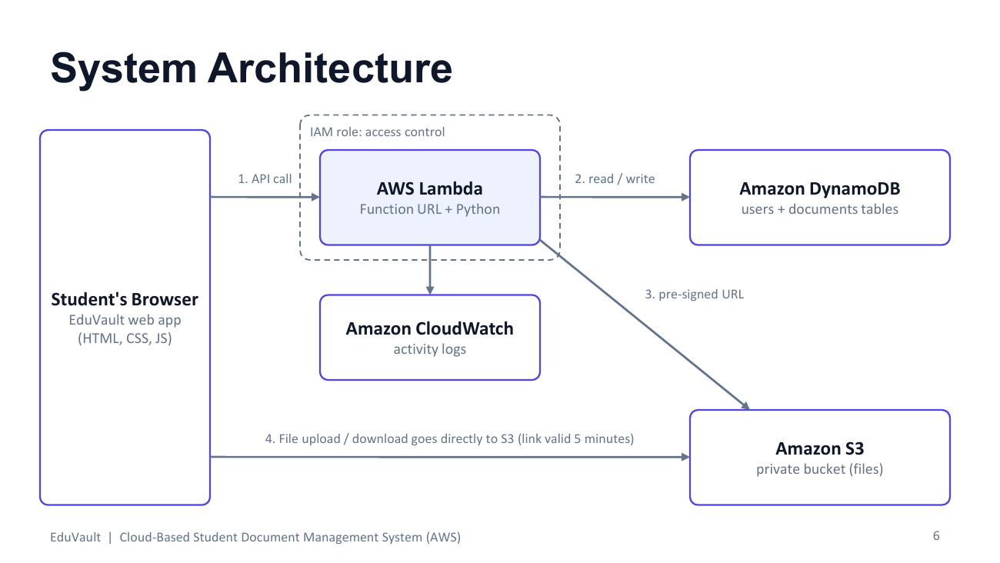

1. The browser sends an API call to the Lambda **Function URL**.
2. Lambda reads/writes metadata in **DynamoDB**.
3. Lambda generates a **pre-signed URL** for S3.
4. The browser uploads/downloads the file **directly to/from S3** (link valid for 5 minutes).
5. Lambda writes activity logs to **CloudWatch**, and runs under an **IAM role** with limited access.

## How It Works

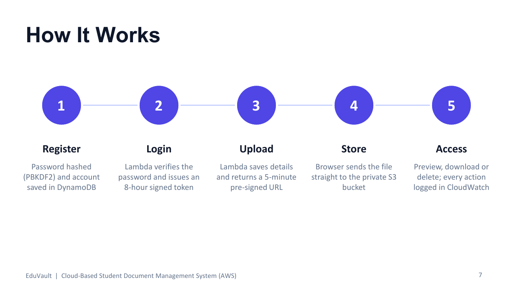

1. **Register** – the password is hashed (PBKDF2) and the account is saved in DynamoDB.
2. **Login** – Lambda verifies the password and issues an 8-hour signed token.
3. **Upload** – Lambda saves the document details and returns a 5-minute pre-signed S3 URL.
4. **Store** – the browser sends the file straight to the private S3 bucket.
5. **Access** – preview, download or delete; every action is logged in CloudWatch.

## Database Design

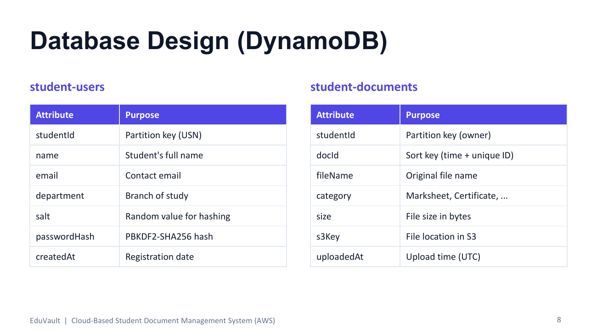

### `student-users`
| Attribute | Purpose |
|-----------|---------|
| `studentId` | Partition key (USN) |
| `name` | Student's full name |
| `email` | Contact email |
| `department` | Branch of study |
| `salt` | Random value for hashing |
| `passwordHash` | PBKDF2-SHA256 hash |
| `createdAt` | Registration date |

### `student-documents`
| Attribute | Purpose |
|-----------|---------|
| `studentId` | Partition key (owner) |
| `docId` | Sort key (time + unique ID) |
| `fileName` | Original file name |
| `category` | Marksheet, Certificate, … |
| `contentType` | MIME type of the file |
| `size` | File size in bytes |
| `s3Key` | File location in S3 (`<studentId>/<docId>/<fileName>`) |
| `uploadedAt` | Upload time (UTC) |

## Security Features

| Feature | Implementation |
|---------|----------------|
| **Password hashing** | PBKDF2-SHA256 with a random salt (100,000 iterations); plain passwords are never stored |
| **Signed session tokens** | HMAC-SHA256 signed, expire after 8 hours; fake or expired tokens are rejected |
| **Private S3 bucket** | Public access blocked; files reachable only via 5-minute pre-signed links |
| **Student isolation** | Student ID is taken from the signed token, so no one can open another student's files |
| **Input validation** | 10 MB size limit, allowed categories only, file names cleaned of unsafe characters |
| **Least-privilege IAM** | Lambda role limited to the required S3, DynamoDB and log actions |
| **Audit logging** | Register, login, failed login, upload, view, download and delete are logged to CloudWatch |

## AWS Console Screenshots

| Amazon S3 | Amazon DynamoDB |
|-----------|-----------------|
| 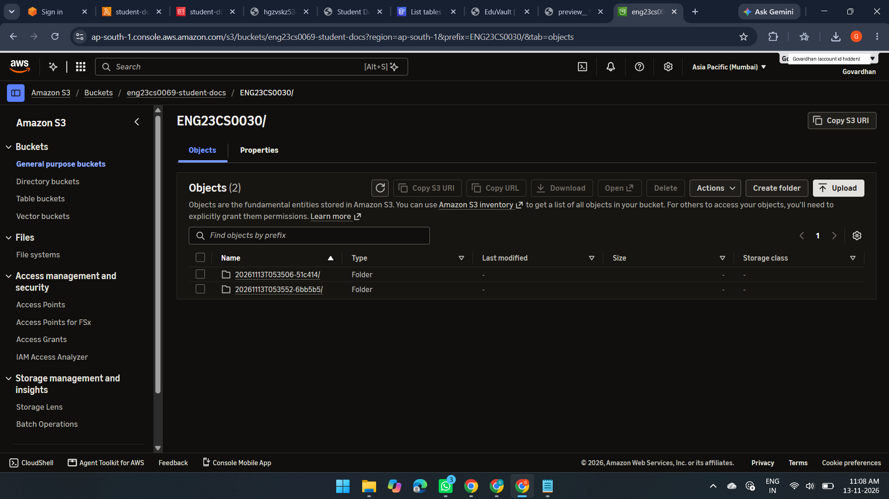 | 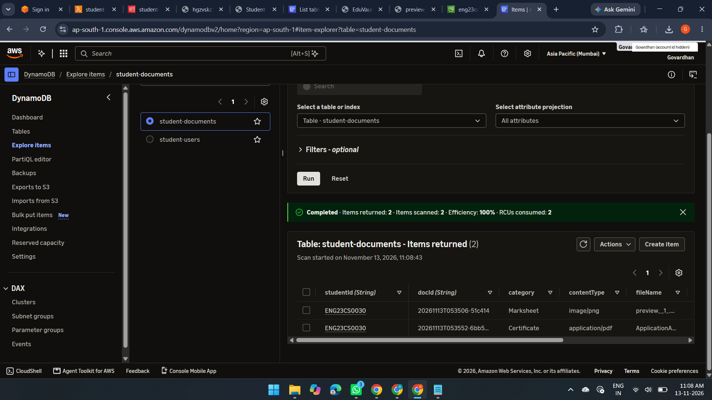 |

| Amazon CloudWatch | AWS Lambda |
|-------------------|------------|
| 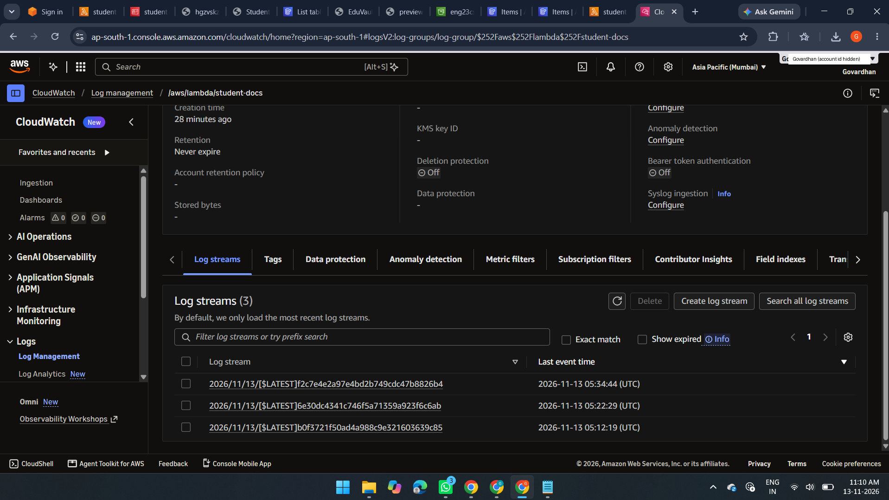 | 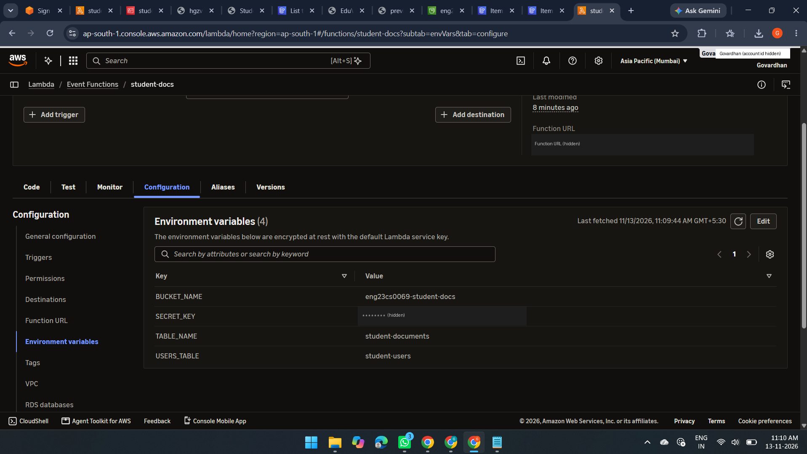 |

## Tech Stack

| Layer | Technology |
|-------|------------|
| Frontend | HTML5, CSS3, Vanilla JavaScript (no framework, no build step), hosted on S3 + CloudFront |
| Backend | Python 3.12 on AWS Lambda (Function URL), `boto3` |
| Database | Amazon DynamoDB |
| File storage | Amazon S3 (pre-signed POST / GET) |
| Access control | AWS IAM |
| Monitoring | Amazon CloudWatch Logs |

## Project Structure

```
eduvault-student-document-management/
├── README.md
├── LICENSE
├── .gitignore
├── frontend/
│   ├── index.html            # Page markup (login, dashboard, documents, upload, profile)
│   ├── css/styles.css        # Styling
│   ├── js/
│   │   ├── config.js         # Lambda Function URL goes here
│   │   └── app.js            # App logic
│   └── README.md
├── backend/
│   ├── lambda_function.py    # AWS Lambda handler
│   ├── iam-policy.json       # Least-privilege policy for the Lambda role
│   ├── s3-cors.json          # S3 bucket CORS rules
│   ├── .env.example          # Required environment variables
│   ├── requirements.txt
│   └── README.md
└── docs/
    ├── API.md                # API reference
    ├── DEPLOYMENT.md         # Step-by-step AWS deployment
    └── images/               # Screenshots and diagrams used in this README
```

## Getting Started

### Prerequisites
- An AWS account
- A modern web browser
- (Optional) Python 3 for serving the frontend locally

### Quick setup
1. **Clone the repo**
   ```bash
   git clone https://github.com/<your-username>/eduvault-student-document-management.git
   cd eduvault-student-document-management
   ```
2. **Create AWS resources** – S3 bucket, two DynamoDB tables, IAM role, Lambda function with a Function URL.
   Follow [`docs/DEPLOYMENT.md`](docs/DEPLOYMENT.md).
3. **Set Lambda environment variables** (see [`backend/.env.example`](backend/.env.example)):
   `BUCKET_NAME`, `TABLE_NAME`, `USERS_TABLE`, `SECRET_KEY`.
4. **Configure the frontend** – paste your Function URL in `frontend/js/config.js`:
   ```js
   const API = "https://xxxxxxxx.lambda-url.ap-south-1.on.aws/";
   ```
5. **Run locally**
   ```bash
   cd frontend
   python -m http.server 8000
   ```
   Open <http://localhost:8000>.
6. **Deploy** – upload the `frontend/` folder to an S3 bucket served through CloudFront
   (live site: <https://d1qub8ki2toxxc.cloudfront.net/>) and invalidate the cache (`/*`) after each update.
7. **CORS** – allow your site origin (`https://d1qub8ki2toxxc.cloudfront.net/`, no trailing slash) in both the S3 bucket CORS
   ([`backend/s3-cors.json`](backend/s3-cors.json)) and the Lambda Function URL CORS settings.

> ⚠️ Never commit your real `SECRET_KEY`. Keep it only in the Lambda environment variables.

## API Reference

All requests are `POST` with JSON to the Lambda Function URL.

| Action | Auth | Purpose |
|--------|------|---------|
| `register` | – | Create a student account |
| `login` | – | Verify credentials, return a signed token |
| `upload` | ✔ | Save metadata and return a pre-signed S3 POST |
| `list` | ✔ | List the student's documents |
| `view` | ✔ | Pre-signed URL to open a file in the browser |
| `download` | ✔ | Pre-signed URL to download a file |
| `delete` | ✔ | Delete the file from S3 and its record from DynamoDB |

Details and examples: [`docs/API.md`](docs/API.md).

## Possible Improvements

- Enforce the 100 MB per-student storage quota on the server (currently shown in the UI only)
- Password reset by email (Amazon SES)
- Edit / rename documents and change category
- Add a custom domain name and HTTPS certificate (AWS Certificate Manager) in front of CloudFront
- Infrastructure as code (AWS SAM / CloudFormation) for one-command deployment

## Conclusion

- EduVault gives students one secure place to store and access their academic documents.
- Built entirely on AWS serverless services: S3, Lambda, DynamoDB, IAM and CloudWatch.
- Secure by design: hashed passwords, signed sessions, private storage, per-student isolation.
- Zero servers, automatic scaling and near-zero cost at college scale.

## License

Released under the [MIT License](LICENSE).

---
<p align="center">Built with ☁️ on AWS · Govardhana J M · ENG23CS0069</p>